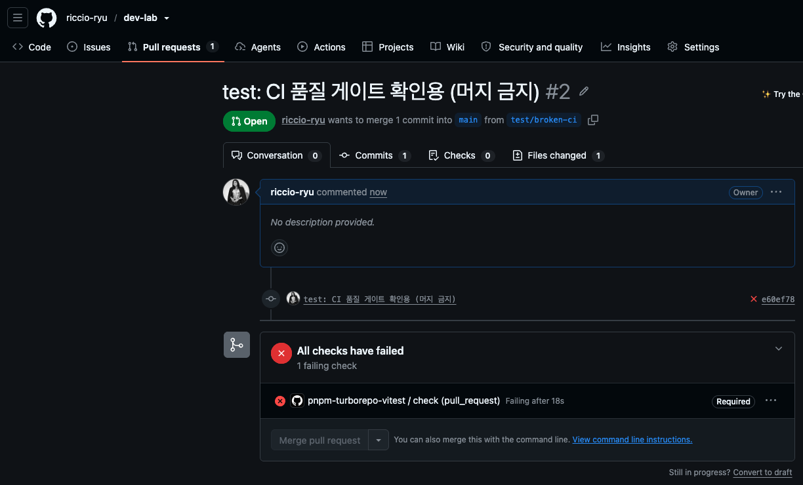
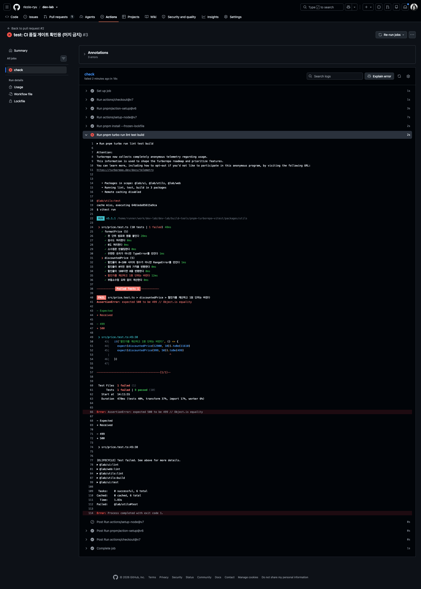

# pnpm + Turborepo + Vitest 모노레포

> 📅 2026-11-19 · 🏷️ pnpm workspace, Turborepo, Vitest, Testing Library, GitHub Actions, Storybook

## 🎯 목적 / 질문

모노레포, 단위 테스트, CI 품질 게이트를 작은 저장소 하나에서 처음부터 직접 구성해 본다.

- `workspace:*`는 무엇이고, 패키지끼리 어떻게 연결되는가?
- `^build`는 무엇이고, turbo 캐시는 왜 빠른가?
- utils는 빌드하고 ui는 소스 그대로 둔 이유는?
- 무엇을 단위 테스트했고, 무엇은 안 했는가?
- 같은 컴포넌트를 여러 번 쓰면 상태는 어떻게 나뉘고, 테스트에서는 어떻게 하나만 골라 찾는가?
- 공용 UI 패키지에 Storybook을 붙이면 단위 테스트와 무엇이 다른가?

## 🛠️ 환경

|            | 버전                                 |
| ---------- | ------------------------------------ |
| Node       | 24.15.0 (`.nvmrc`)                   |
| pnpm       | 12.21.0 (corepack, `packageManager`) |
| Turborepo  | 2.x                                  |
| Next       | 16.x (App Router)                    |
| React      | 19.x                                 |
| TypeScript | 5.9                                  |
| Storybook  | 10.x (`@storybook/react-vite`, ui만) |

## ▶️ 실행 방법

```bash
nvm use                # .nvmrc → 24.15.0
corepack enable pnpm   # packageManager에 적힌 pnpm 버전을 받아서 쓴다
pnpm install

pnpm dev               # http://localhost:3000
pnpm --filter @lab/ui storybook   # http://localhost:6006 (ui 컴포넌트 카탈로그)
pnpm turbo run lint test build
```

> corepack은 실행할 때 쓰던 Node의 bin 폴더에만 `pnpm` 링크를 만든다. 다른 Node 버전으로 바꾼 터미널에서는 `pnpm: command not found`가 난다. 먼저 `nvm use`를 실행한다.

## 📁 구성

```
pnpm-turborepo-vitest/
├── apps/
│   └── web/          # Next App Router. 상품 카드 5개. @lab/ui, @lab/utils를 workspace:*로 쓴다
└── packages/
    ├── utils/        # 가격 유틸. tsup으로 dist를 만든다 (빌드하는 패키지)
    └── ui/           # Button, QuantitySelector. .tsx 소스를 그대로 내보낸다. Storybook(.storybook/, *.stories.tsx)
```

| 패키지       | 내보내는 것                        | 빌드 | 앱에서 쓰는 방법                    |
| ------------ | ---------------------------------- | ---- | ----------------------------------- |
| `@lab/utils` | `dist/index.js`, `dist/index.d.ts` | tsup | 빌드된 JS를 그대로 import           |
| `@lab/ui`    | `src/index.ts`                     | 없음 | Next가 `transpilePackages`로 컴파일 |

**utils만 빌드하는 이유**

- utils는 순수 TypeScript라서 tsup 설정 몇 줄로 빌드할 수 있다. 빌드해 두면 Next가 아닌 곳(다른 앱, 서버)에서도 그대로 쓸 수 있다.
- ui는 React 컴포넌트와 CSS Modules가 섞여 있다. 빌드하려면 CSS 처리 설정이 따로 필요하다. 같은 저장소의 Next 앱만 쓰므로 소스 그대로 두고 Next가 컴파일하게 했다.

**turbo 태스크** (`turbo.json`)

| 태스크  | 의존                                    | 캐시 대상                                  |
| ------- | --------------------------------------- | ------------------------------------------ |
| `build` | `^build` (의존하는 패키지의 build 먼저) | `dist/**`, `.next/**` (`.next/cache` 제외) |
| `test`  | `^build`                                | 없음 (로그만)                              |
| `lint`  | 없음                                    | 없음 (로그만)                              |
| `dev`   | 없음                                    | 캐시 안 함                                 |

## 🚦 CI 품질 게이트

- 워크플로: [`.github/workflows/pnpm-turborepo-vitest.yml`](../../.github/workflows/pnpm-turborepo-vitest.yml)
  - 모든 PR에서 돌되, `changes` job이 이 폴더가 바뀌었는지 먼저 본다. 바뀐 PR에서만 `check` job이 `pnpm turbo run lint test build`를 돈다.
  - 처음에는 `pull_request`에 `paths`를 걸었다. 그런데 `check`가 필수 체크라서, 다른 실험만 고친 PR에서는 `check`가 아예 안 떠서 머지가 영영 막힌다(최종 리뷰에서 발견). 건너뛴 job은 필수 체크에서 통과로 쳐서, `if`로 건너뛰는 방식으로 바꿨다.
- main에는 브랜치 보호 규칙(Ruleset)을 걸었다.
  - PR을 거쳐야만 머지할 수 있다.
  - `check`가 통과해야 머지할 수 있다.

일부러 `Math.floor`를 `Math.round`로 바꾼 PR을 올려서 확인했다.



<details>
<summary>실패 로그 (expected 500 to be 499)</summary>



</details>

## 🔬 해본 것

1. pnpm workspace로 앱 1개(`apps/web`)와 패키지 2개(`packages/utils`, `packages/ui`)를 묶고, 앱에서 `workspace:*`로 연결했다.
   - 설치하면 `apps/web/node_modules/@lab/*`가 `packages/` 폴더를 가리키는 심볼릭 링크로 생긴다.
2. utils는 tsup으로 빌드하고, ui는 `.tsx` 소스를 그대로 내보내 Next의 `transpilePackages`로 컴파일하게 나눴다.
3. `turbo.json`에서 `build`와 `test`를 `^build`에 걸어, 항상 utils가 먼저 빌드되게 했다.
4. 같은 명령(`pnpm turbo run lint build`)을 세 번 돌려 캐시가 동작하는 방식을 확인했다.
5. Vitest로 utils 가격 함수 테스트 10개를 작성했다.
   - 경계값: 할인율 0%, 100%
   - 에러: `NaN`, 할인율 101
   - 버림: 999원 50% → 499원
   - 부동소수점: 700원 30% → 490원
6. Testing Library로 ui 수량 선택기 테스트 6개를 작성했다.
   - 버튼은 `getByRole`과 접근 가능한 이름으로 찾았다.
   - 클릭은 `userEvent`로 했다.
7. 코드를 일부러 망가뜨려서, 테스트가 그 버그를 잡는지 하나씩 확인했다.
8. GitHub Actions에서 PR마다 `pnpm turbo run lint test build`를 돌리고, main 브랜치 보호 규칙으로 `check` 통과를 머지 조건으로 걸었다.
9. 테스트를 깨뜨린 PR을 올려 머지가 막히는 것을 확인했다(위 캡처).
10. 상품 하나만 있던 화면을 상품 5개(무선 이어폰, 노트북, 태블릿, 키보드, 마우스)로 늘렸다.
    - `ProductCard`가 `name`, `price`, `rate`를 props로 받는다. 상품 배열을 `map`으로 렌더링한다.
    - 같은 `QuantitySelector`를 카드마다 쓰고, 수량은 카드마다 `useState`로 따로 둔다.
    - 카드는 `<section aria-labelledby>`로 감싸 상품 이름을 접근 가능한 이름으로 붙였다. id는 `useId`로 만들어 겹치지 않게 했다.
    - 키보드는 할인 0%로 두고, 할인이 없으면 가격만 보여 준다.
11. web에도 Vitest를 붙이고(ui 설정을 그대로 옮김) 상품 목록 테스트 5개를 작성했다.
    - 「수량 늘리기」 버튼이 5개라 `within(screen.getByRole('region', { name: '노트북' }))`으로 카드 안에서만 찾았다.
    - 노트북 수량을 바꾼 뒤 마우스 수량이 그대로인지 확인했다.
12. ui 패키지에 Storybook 10을 붙였다.
    - `storybook init` 대신 패키지 4개를 직접 설치하고 `.storybook/main.ts`·`preview.ts`를 썼다.
    - `Button` story 3개(Primary, Secondary, Disabled)와 `QuantitySelector` story 5개(Default, AtMin, AtMax, CustomMax, ClickIncrease)를 썼다. `tags: ['autodocs']`로 Docs 페이지도 생긴다.
    - `QuantitySelector`는 `value`를 밖에서 받아야 움직여서, meta의 `render`에서 `useArgs`로 버튼을 누를 때 `args.value`를 바꾸게 했다.
13. ClickIncrease에 play 함수를 붙여, story가 그려지면 늘리기 버튼을 누르고 4가 되는지와 `onChange(4)`를 자동으로 확인했다.

## ✅ 결과 & 배운 점

**turbo 캐시** (`pnpm turbo run lint build`, 로컬. 측정할 때는 아직 테스트가 없어서 `test`를 뺐다)

| 회차 | 상태                                | 실행된 태스크                      | 시간               |
| ---- | ----------------------------------- | ---------------------------------- | ------------------ |
| 1    | `dist`, `.next`, `.turbo` 모두 지움 | 5개 모두                           | 7.358s             |
| 2    | 아무것도 안 바꿈                    | 0개 (모두 cache hit)               | 14ms, `FULL TURBO` |
| 3    | `utils/src/price.ts`에 주석 한 줄   | utils#build, utils#lint, web#build | 3.872s             |

- 3회차에서 web#build는 다시 돌았지만 web#lint는 캐시로 끝났다. `build`는 `^build`에 의존해서 utils가 바뀌면 같이 다시 빌드된다. 반면 `lint`는 의존이 없어서 자기 패키지 파일만 본다.
- 테스트 파일만 고쳐도 utils#build 캐시가 깨졌다. turbo는 기본적으로 패키지 안의 모든 파일을 캐시 판단에 넣는다. `inputs`에서 테스트 파일을 빼면 해결된다.

**단위 테스트**

- 테스트가 없는 함수는 망가져도 초록불이다. `formatPrice` 테스트만 있을 때 `discountedPrice`를 `Math.round`로 바꿨는데 아무 에러도 나지 않았다.
- 일부러 넣은 버그 4개는 각각 그 버그를 겨냥한 테스트 1개만 실패했다.

| 넣은 버그                              | 실패한 테스트                                                    |
| -------------------------------------- | ---------------------------------------------------------------- |
| `Math.floor` → `Math.round`            | 1원 단위는 버린다 (`expected 500 to be 499`)                     |
| 정수 곱셈 → `price * (1 - rate / 100)` | 부동소수점 오차 없이 계산한다 (`700 * 0.7 = 489.99999999999994`) |
| `value <= min` → `value < min`         | 수량이 1이면 줄이기 버튼 비활성화                                |
| `max`를 무시하고 99 고정               | max를 주면 늘리기 버튼 비활성화                                  |

- 마지막 버그는 처음 쓴 테스트(기본값 99만 확인)로는 잡지 못했다. 기본값만 테스트하면 prop이 실제로 쓰이는지 알 수 없다.
- `getByRole`의 `name`은 접근 가능한 이름이다. `aria-label`이 있으면 화면 글자(`+`, `-`) 대신 `aria-label`로 찾는다. 사용자가 듣는 이름으로 찾기 때문에, 그 이름이 바뀌면 테스트도 깨지는 게 맞다.

**여러 상품**

web 상품 목록 테스트도 같은 방식으로 버그를 하나씩 넣어 봤다.

| 넣은 버그                                  | 실패한 테스트                |
| ------------------------------------------ | ---------------------------- |
| `<section>`에서 `aria-labelledby` 제거     | 5개 모두                     |
| 할인 0%도 할인 표시 (`rate > 0` → `>= 0`)  | 키보드 할인 표시 1개         |
| 합계를 할인 전 가격으로 계산               | 합계 1개                     |
| 카드 5개가 수량 하나를 같이 씀 (모듈 변수) | 마우스 수량 유지, 합계 (2개) |

- `aria-labelledby`를 빼면 `<section>`에 이름이 없어져 `region`으로 잡히지 않는다. 그래서 카드를 찾는 테스트가 전부 실패했다. 스크린 리더에서도 카드가 「노트북 영역」으로 읽히지 않는다. 테스트가 접근 가능한 이름까지 함께 지키고 있었다.
- 수량을 같이 쓰게 만든 버그는 모듈 변수라서 테스트가 끝나도 값이 남았다. 앞 테스트가 2로 바꾼 상태에서 시작해 합계 테스트도 같이 깨졌다. `useState`는 컴포넌트를 쓸 때마다 상태가 새로 생겨서 이런 일이 없다.
- 테스트마다 `cleanup`이 화면을 비우기 때문에, `render`를 빼먹으면 `<body />`가 빈 채로 「There are no accessible roles」 에러가 난다.

**Storybook**

- story는 「props를 정해 둔 화면 하나」다. `args`가 곧 props라서, 테스트의 `render(<Button disabled>품절</Button>)`를 `args: { children: '품절', disabled: true }`로 적어 두는 셈이다. 단위 테스트는 맞는지 확인하고, story는 상태별로 눈으로 보고 Controls로 props를 바꿔 볼 수 있다.
- 처음에는 `render`에서 `useState(args.value)`로 수량을 들었다. `useState`의 초기값은 처음 한 번만 쓰여서, Controls에서 `value`를 바꿔도 화면이 따라오지 않는다. `useArgs`로 args를 직접 바꾸게 해서 Controls와 버튼이 같은 값을 보게 했다.
- 그런데 `useArgs`를 쓴 채로 play 함수를 붙이자 문제가 두 개 생겼다.
  - 클릭 직후 `getByText('4')`가 실패했다. `updateArgs`는 Storybook 바깥에 요청을 보냈다가 돌아와야 다시 그려서, 그 순간 화면은 아직 3이었다.
  - 바뀐 값이 주소에 `&args=value:4`로 저장됐다. 다시 열면 4에서 시작해 play가 또 눌러서, 열 때마다 1씩 커졌다.
  - play를 붙이는 story만 `useState`로 수량을 자기 상태로 들게 해서 해결했다. React가 클릭을 처리하면서 바로 다시 그려 `getByText`로도 찾는다.
- Storybook을 빌드한 뒤 `pnpm lint`가 빌드 결과(`storybook-static/`)까지 검사해서 에러가 1만 개 넘게 났다. ESLint `ignores`와 `.gitignore`에 넣었다.

**CI 품질 게이트**

- 캐시가 없는 CI에서 전체 실행은 약 30초 걸렸다.
- 테스트가 실패한 PR에서 turbo는 `Tasks: 0 successful, 6 total`로 끝났고, web#build는 실행되지 않았다. `check`가 빨간불이 되자 Merge 버튼이 비활성화됐다.
- 첫 PR은 브랜치 보호를 켜기 전에 머지했다. 그래서 머지 차단은 PR을 새로 만들어 확인했다. 규칙은 저장소를 만들 때 먼저 걸어 두는 게 맞다.

**설정하면서 만난 것**

- pnpm은 의존성의 설치 스크립트를 기본으로 막는다(`ERR_PNPM_IGNORED_BUILDS`). tsup이 쓰는 esbuild만 `allowBuilds`로 허용했다.
- eslint-config-next의 플러그인이 아직 ESLint 10을 지원하지 않아서 web만 ESLint 9를 쓴다. 모노레포라 패키지마다 버전을 다르게 둘 수 있다.
- `corepack enable`은 그때 쓰던 Node에만 `pnpm`을 연결한다. Node 20에 머물러 있던 터미널에서 `pnpm: command not found`가 나서 `.nvmrc`를 추가했다.

## 🔗 참고 링크

- [pnpm workspace](https://pnpm.io/workspaces)
- [Turborepo: Internal packages](https://turborepo.com/docs/core-concepts/internal-packages)
- [Turborepo: Caching](https://turborepo.com/docs/crafting-your-repository/caching)
- [Next.js: transpilePackages](https://nextjs.org/docs/app/api-reference/config/next-config-js/transpilePackages)
- [Storybook: Args](https://storybook.js.org/docs/writing-stories/args)
- [Storybook: Play function](https://storybook.js.org/docs/writing-stories/play-function)
